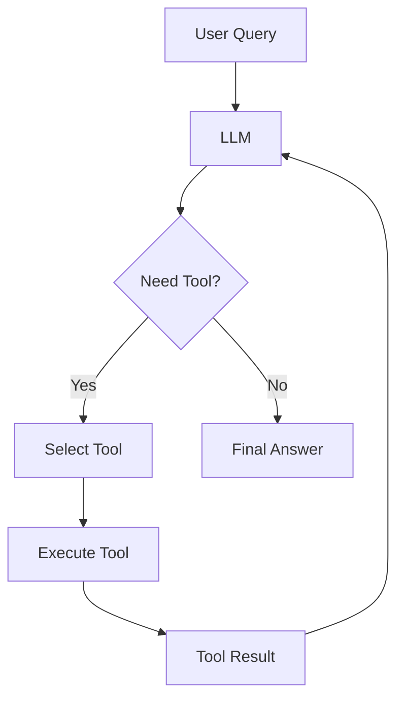
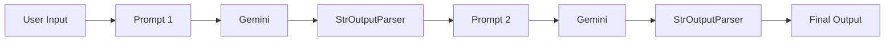
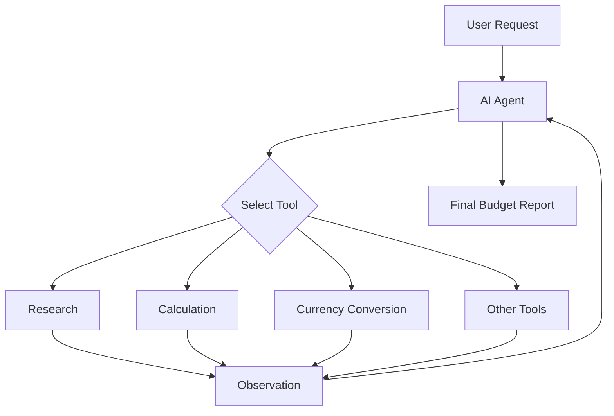
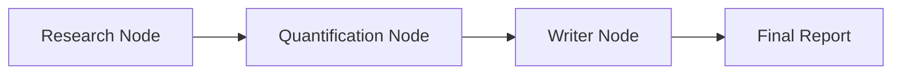
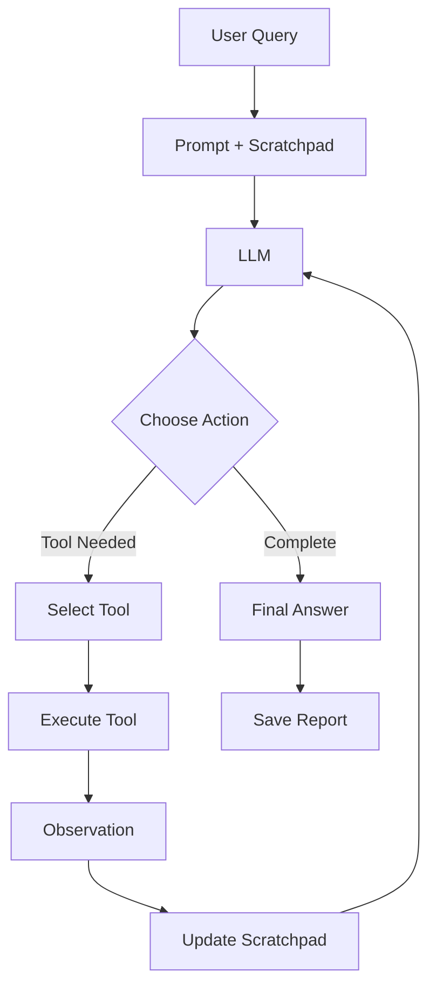
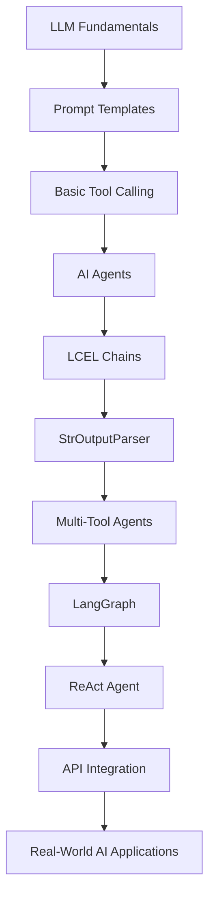

# Create AI Agents Using LangChain

<div align="center">

**A hands-on learning repository for building AI agents, LCEL chains, and multi-step AI workflows using LangChain, LangGraph, and Google Gemini.**


</div>

---

## 📌 Overview

This repository demonstrates how to build AI agents and LLM-powered applications step by step using **LangChain, LangGraph, and Google Gemini**.

The project starts with simple tool-calling agents and LCEL chains, gradually progressing toward multi-step autonomous workflows and a ReAct agent capable of using multiple tools.

It is designed for students, beginners, and developers who want practical experience with:

- Large Language Models (LLMs)
- Prompt engineering
- LangChain tools
- AI agents and tool calling
- LCEL (LangChain Expression Language)
- `StrOutputParser`
- LangGraph `StateGraph`
- ReAct agent architecture
- Agent execution and tool orchestration
- API integration
- Automated report generation

---

## 🎯 Learning Objectives

By completing the notebooks, you will understand how to:

1. Connect an LLM with external tools.
2. Create custom tools using the `@tool` decorator.
3. Build AI agents that decide when to use tools.
4. Create sequential LLM pipelines using LCEL.
5. Understand the role of `StrOutputParser`.
6. Visualize LangChain execution graphs.
7. Build multi-step workflows using LangGraph.
8. Use multiple tools within a single AI agent.
9. Integrate APIs with AI agents.
10. Generate and save reports automatically.

---

## 📚 Project Structure

```text
Create-agent-by-using-the-LangChain/
│
├── 01_basic_create_agent.ipynb
│   └── Basic tool-calling agent
│
├── 02_lcel_str_output_parser.ipynb
│   └── LCEL chains and StrOutputParser
│
├── 03_five_tool_budget_agent.ipynb
│   └── Multi-tool agent and LangGraph workflow
│
├── 04_ten_tool_react_agent.ipynb
│   └── ReAct agent with multiple tools
│
├── requirements.txt
│
├── .env.example
│
└── README.md
```

---

# 🚀 Learning Modules

## 1. Basic Tool-Calling Agent

**Notebook:** `01_basic_create_agent.ipynb`

Learn how to build a basic AI agent that can use external tools.

### Concepts Covered

- Initializing Google Gemini
- Creating custom tools using `@tool`
- Integrating a web search tool
- Creating mathematical tools
- Using an AI agent to select and execute tools
- Understanding tool calling

### Tools Used

| Tool | Purpose |
|---|---|
| DuckDuckGo Search | Search for information on the internet |
| Multiply Tool | Perform mathematical multiplication |

### Architecture



### Example Tasks

```text
What is the latest information about LangChain?

Calculate 245 multiplied by 36.

Search for information about AI agents and explain them.
```

---

## 2. LCEL Chains and StrOutputParser

**Notebook:** `02_lcel_str_output_parser.ipynb`

Learn how to build sequential LLM pipelines using LangChain Expression Language (LCEL).

### Concepts Covered

- `PromptTemplate`
- `ChatGoogleGenerativeAI`
- `StrOutputParser`
- LCEL chaining using `|`
- Sequential prompt execution
- Passing output between multiple LLM calls
- Visualizing chains using `get_graph()`
- Displaying execution graphs using `grandalf`

### Pipeline Architecture



### Example

The pipeline performs two operations:

1. Generate a detailed report about a given topic.
2. Summarize the generated report into two lines.

```python
from langchain_core.prompts import PromptTemplate
from langchain_core.output_parsers import StrOutputParser
from langchain_google_genai import ChatGoogleGenerativeAI

# Initialize the LLM
llm = ChatGoogleGenerativeAI(
    model="YOUR_SUPPORTED_GEMINI_MODEL",
    temperature=0
)

# Initialize the output parser
parser = StrOutputParser()

# Prompt 1: Generate a detailed report
template1 = PromptTemplate(
    template="Write a detailed report on {topic}.",
    input_variables=["topic"]
)

# Prompt 2: Summarize the report
template2 = PromptTemplate(
    template="Write a two-line summary of the following text:\n\n{text}",
    input_variables=["text"]
)

# Create the LCEL chain
chain = (
    template1
    | llm
    | parser
    | template2
    | llm
    | parser
)

# Execute the chain
result = chain.invoke({
    "topic": "Ollama"
})

print(result)
```

### Visualize the Chain

```python
chain.get_graph().print_ascii()
```

This helps you understand the execution flow of an LCEL pipeline.

---

## 3. Five-Tool Budget Planning Agent

**Notebook:** `03_five_tool_budget_agent.ipynb`

This notebook demonstrates how AI agents can solve practical multi-step problems.

The agent is designed to perform research, calculations, and report generation using tools.

### Concepts Covered

- Multiple tools
- Tool selection
- Multi-step reasoning
- Research and calculations
- Currency conversion
- Report generation
- LangGraph
- `StateGraph`
- Nodes and edges
- Workflow orchestration

### Part A — Single-Agent Workflow

In this approach, one AI agent controls the tools and decides which tool to execute based on the user's request.



### Part B — LangGraph Workflow

In this approach, the workflow is divided into multiple nodes.

Each node performs a specific task.



### Workflow Responsibilities

| Node | Responsibility |
|---|---|
| Research Node | Gather relevant information |
| Quantification Node | Perform calculations and budget estimation |
| Writer Node | Generate the final structured report |

### Learning Outcome

Understand the difference between:

- An agent that dynamically decides which tools to use.
- A graph-based workflow with predefined execution stages.

---

## 4. Ten-Tool ReAct Agent

**Notebook:** `04_ten_tool_react_agent.ipynb`

This is the capstone notebook of the repository.

Build a ReAct-based AI agent that can interact with multiple tools, perform research, calculate values, retrieve information, and generate reports.

### Concepts Covered

- ReAct architecture
- Thought–Action–Observation loop
- `PromptTemplate`
- Agent scratchpad
- Tool descriptions
- Tool selection
- `create_react_agent`
- `AgentExecutor`
- Iterative tool execution
- Error handling
- Maximum iteration limits
- API integration
- File generation

### Tool Categories

The agent integrates ten tools covering different functionalities.

| Category | Functionality |
|---|---|
| Research | Web search using Tavily |
| Weather | Retrieve weather information |
| Date & Time | Get the current date |
| Mathematics | Perform calculations |
| Currency | Convert currencies |
| Unit Conversion | Convert measurement units |
| Information | Retrieve relevant information |
| Planning | Provide recommendations |
| Budgeting | Estimate expenses |
| File Operations | Save reports to files |

> The exact tool names, API requirements, and implementations are defined inside the notebook.

### ReAct Architecture



### ReAct Execution Cycle

```text
Thought
   ↓
Action
   ↓
Action Input
   ↓
Observation
   ↓
Thought
   ↓
Action
   ↓
Observation
   ↓
Final Answer
```

The agent repeats this cycle until it has enough information to answer the user's query.

### Example Task

```text
Check today's date.

Search for recent local news in Chennai using Tavily.

Fetch the weather information for Chennai.

Convert Celsius to Fahrenheit.

Provide an outdoor activity recommendation.

Calculate the budget for a two-day workshop
for 10 students in INR.

Add a 10% contingency buffer.

Convert the final amount to USD.

Save the final report to:

chennai_student_brief.txt
```

### Agent Implementation

The notebook uses the ReAct agent and executor pattern.

```python
from langchain_classic.agents import (
    AgentExecutor,
    create_react_agent
)

# Create the ReAct agent
react_agent = create_react_agent(
    llm=llm,
    tools=tools,
    prompt=prompt
)

# Create the executor
agent_executor = AgentExecutor(
    agent=react_agent,
    tools=tools,
    verbose=True,
    handle_parsing_errors=True,
    max_iterations=25
)

# Execute the agent
result = agent_executor.invoke({
    "input": "Prepare a student workshop report for Chennai."
})

print(result["output"])
```

> **Note:** `create_react_agent` and `AgentExecutor` are legacy-style agent APIs available through `langchain-classic` in newer LangChain versions. They are used here for learning the ReAct architecture.

---

# 🛠️ Technologies Used

| Technology | Purpose |
|---|---|
| Python | Programming language |
| LangChain | LLM application development |
| LangChain Community | Community integrations and tools |
| LangChain Classic | Legacy ReAct agent implementation |
| LangGraph | Graph-based workflow orchestration |
| Google Gemini | LLM |
| DuckDuckGo | Web search |
| Tavily | AI-oriented web search |
| Weatherstack | Weather API |
| Requests | API communication |
| Grandalf | Chain graph visualization |
| Jupyter Notebook | Interactive development |
| Google Colab | Cloud notebook environment |

---

# 📦 Installation

## Option 1 — Google Colab

Open the notebook in Google Colab.

Install the dependencies:

```python
!pip install -U langchain langchain-community langchain-core langchain-google-genai langgraph langchain-classic ddgs tavily-python requests grandalf python-dotenv
```

If you encounter dependency issues, restart the Colab runtime after installation.

---

## Option 2 — Local Environment

### Step 1: Clone the Repository

```bash
git clone https://github.com/007arjungangwar/Create-agent-by-using-the-LangChain.git
```

Navigate into the repository:

```bash
cd Create-agent-by-using-the-LangChain
```

### Step 2: Create a Virtual Environment

```bash
python -m venv venv
```

### Activate the Environment

**Windows:**

```bash
venv\Scripts\activate
```

**Linux / macOS:**

```bash
source venv/bin/activate
```

### Step 3: Install Dependencies

```bash
pip install -U pip
pip install -r requirements.txt
```

### Step 4: Launch Jupyter Notebook

```bash
jupyter notebook
```

---

# 📄 requirements.txt

Create a `requirements.txt` file with:

```text
langchain
langchain-community
langchain-core
langchain-google-genai
langchain-classic
langgraph
ddgs
tavily-python
requests
grandalf
python-dotenv
jupyter
ipykernel
```

> This repository uses both modern LangChain APIs and the legacy ReAct API. Installing the packages together in a clean environment is recommended. If a notebook contains imports from older LangChain versions, package compatibility may require adjustments.

---

# 🔑 API Configuration

Some notebooks require API keys.

| API | Purpose | Required For |
|---|---|---|
| Google Gemini API | LLM | All LLM-based notebooks |
| Tavily API | Web search | ReAct agent |
| Weatherstack API | Weather information | ReAct agent |

You may need additional API keys depending on the tools implemented in the notebooks.

---

## Google Gemini API

Get your API key from Google AI Studio:

https://aistudio.google.com/

Set the environment variable:

**Windows PowerShell:**

```powershell
$env:GOOGLE_API_KEY="YOUR_API_KEY"
```

**Linux / macOS:**

```bash
export GOOGLE_API_KEY="YOUR_API_KEY"
```

### Google Colab

Use Colab Secrets instead of hardcoding your API key.

```python
from google.colab import userdata

GOOGLE_API_KEY = userdata.get("GOOGLE_API_KEY")
```

---

## Tavily API

Get your API key:

https://tavily.com/

Set the environment variable:

```bash
TAVILY_API_KEY="YOUR_API_KEY"
```

---

## Weatherstack API

Get your API key:

https://weatherstack.com/

Set the environment variable:

```bash
WEATHERSTACK_API_KEY="YOUR_API_KEY"
```

---

## Local `.env` Configuration

For local development, create a `.env` file in the project directory.

```env
GOOGLE_API_KEY=your_google_api_key
TAVILY_API_KEY=your_tavily_api_key
WEATHERSTACK_API_KEY=your_weatherstack_api_key
```

Load the environment variables:

```python
from dotenv import load_dotenv

load_dotenv()
```

Access the keys:

```python
import os

GOOGLE_API_KEY = os.getenv("GOOGLE_API_KEY")
TAVILY_API_KEY = os.getenv("TAVILY_API_KEY")
WEATHERSTACK_API_KEY = os.getenv("WEATHERSTACK_API_KEY")
```

### Security

Never upload your `.env` file or API keys to GitHub.

Add the following to your `.gitignore`:

```gitignore
.env
venv/
__pycache__/
.ipynb_checkpoints/
```

---

# 🧠 Understanding the Main Components

## What is an LLM?

A Large Language Model (LLM) is an AI model capable of understanding and generating human-like text.

Examples include:

- Google Gemini
- OpenAI GPT
- Claude
- Llama
- Qwen

---

## What is LangChain?

LangChain is a framework for developing applications powered by language models.

It provides components for:

- Prompts
- Models
- Chains
- Tools
- Agents
- Structured outputs
- Integrations

---

## What is a Tool?

A tool allows an AI model to interact with external functionality.

Examples:

- Searching the web
- Performing calculations
- Reading files
- Calling APIs
- Retrieving weather information
- Sending notifications

---

## What is an AI Agent?

An AI agent uses an LLM to determine which actions are required to complete a task.

Unlike a simple sequential chain, an agent can dynamically select tools based on the user's request.

---

## What is LCEL?

LangChain Expression Language (LCEL) allows you to combine components using the pipe operator `|`.

Example:

```python
chain = prompt | llm | parser
```

The components execute sequentially, with each component passing its output to the next.

---

## What is LangGraph?

LangGraph is used to build stateful and controllable workflows involving multiple nodes and execution paths.

It is useful for:

- Multi-step AI workflows
- Conditional execution
- Agent orchestration
- State management
- Human-in-the-loop applications
- Complex agent systems

---

## What is ReAct?

ReAct stands for **Reasoning and Acting**.

It combines reasoning with actions by allowing an LLM to decide which tools to use, observe the results, and continue until a task is complete.

---

# 📈 Learning Roadmap



---

# 💡 Suggested Projects

After completing the notebooks, try building:

1. AI Research Assistant
2. AI Travel Planner
3. Student Academic Assistant
4. AI News Summarizer
5. Weather-Based Travel Assistant
6. AI Budget Planner
7. AI Report Generator
8. Web Research Agent
9. Multi-Agent Workflow
10. AI Chatbot with Tools

---

# 👨‍💻 Author

**Arjun Singh Gangwar**

Lecturer | Data Science | Machine Learning | Generative AI | Agentic AI

Areas of interest:

- Artificial Intelligence
- Generative AI
- Agentic AI
- Machine Learning
- Deep Learning
- Natural Language Processing
- Computer Vision
- Data Science
- MLOps

---

# ⭐ Support

If you find this repository useful for learning LangChain and AI agents:

- ⭐ Star the repository
- 🍴 Fork it
- 📚 Use it for learning
- 🛠️ Improve the notebooks
- 📢 Share it with other learners

---

<div align="center">

**Learn → Build → Experiment → Create AI Agents**

</div>
